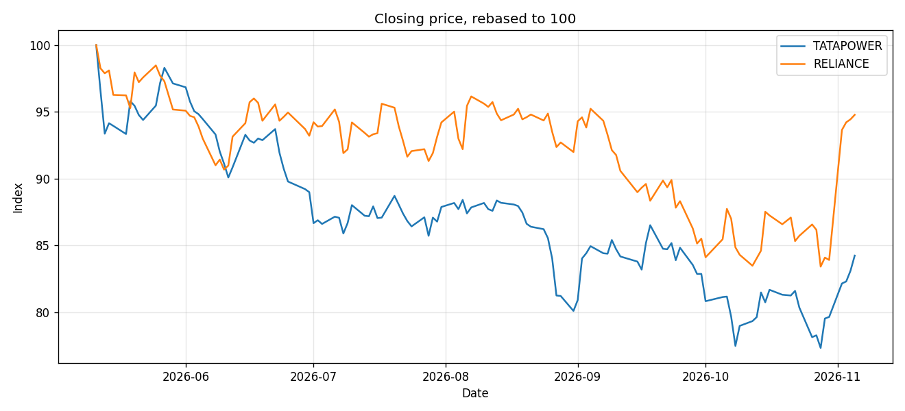

# NSE Stock Comparison with Skip Lists

Compare two National Stock Exchange (India) stocks over their **common trading
days**, using a **skip list** built from scratch as the date-ordered index.

```bash
$ python stocks.py TATAPOWER RELIANCE --days 180
TATAPOWER: 124 days | RELIANCE: 124 days | common: 124
  TATAPOWER        433.20 ->     364.95  (-15.8%)
  RELIANCE        1388.20 ->    1315.70  (-5.2%)
  daily-return correlation: 0.35
  TATAPOWER closes in the last 30 days (range query): 22 rows
Saved comparison.png
```



## Why a skip list?

Every stock is stored as a sorted map `date → closing price`. A skip list
supports exactly the operations this needs, and it is a simpler alternative
to a balanced BST:

| Operation | Used for | Cost |
|---|---|---|
| `insert(date, close)` | building the index | O(log n) expected |
| `get(date)` | price lookup on a given day | O(log n) expected |
| `range(lo, hi)` | "all closes in the last 30 days" | O(log n + k) |
| `intersection(other)` | trading days both stocks share | O(n + m) linear merge |
| `delete(date)` | removing bad rows | O(log n) expected |

### How it works

```
Level 3:  head ─────────────────────────────► 14 ────────────────► None
Level 2:  head ─────────► 05 ───────────────► 14 ────────► 21 ───► None
Level 1:  head ─► 02 ───► 05 ─────► 09 ─────► 14 ─► 17 ──► 21 ───► None
Level 0:  head ─► 02 ─► 03 ─► 05 ─► 09 ─► 11 ─► 14 ─► 17 ─► 19 ─► 21 ─► None
```

- Level 0 is a sorted linked list of all keys. Each node is also promoted
  to the next level up with probability `p = 0.5`, so level *i* holds about
  *n / 2ⁱ* nodes.
- **Search** starts at the top level and moves right while the next key is
  smaller than the target, then drops a level. Each level roughly halves the
  remaining range, which gives O(log n) expected time with no rebalancing.
- **Intersection** walks level 0 of both lists at once, like the merge step
  of merge sort. That is O(n + m), better than doing *n* separate searches
  (O(n log m)) when the lists are of similar size.

The implementation is in [`skiplist.py`](skiplist.py) and has no
dependencies. Tests check it against a Python `dict` over 2,000 random
operations.

## Usage

```bash
pip install -r requirements.txt

# Live data (Yahoo Finance, NSE tickers)
python stocks.py TATAPOWER RELIANCE --days 365

# Or offline, from CSVs downloaded on nseindia.com → stock page → Historical Data → Download
python stocks.py --csv TATAPOWER.csv RELIANCE.csv

pytest -q
```

## Project structure

```
├── skiplist.py            # SkipList: insert/get/delete/range/intersection
├── stocks.py              # data loading (yfinance or NSE CSV), comparison, plot
└── tests/test_skiplist.py # randomized reference test, range, intersection, CSV parsing
```

## History

v1 drove a real Chrome browser with Selenium to click through nseindia.com.
It broke whenever the site layout changed, needed a local chromedriver, and
had to evade NSE's bot detection. v2 replaces the scraping with NSE's
official CSV export or the Yahoo Finance API. It also fixes the original
skip-list design, which was keyed by **price**, so its "intersection"
matched two stocks that happened to close at the same value. The list is now
keyed by **date**, which makes the intersection meaningful.
